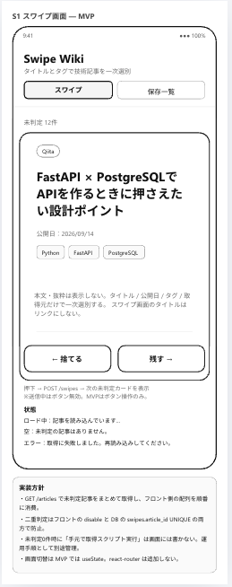
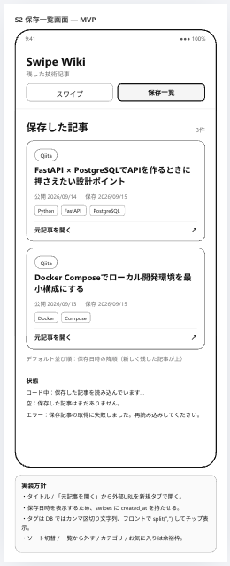
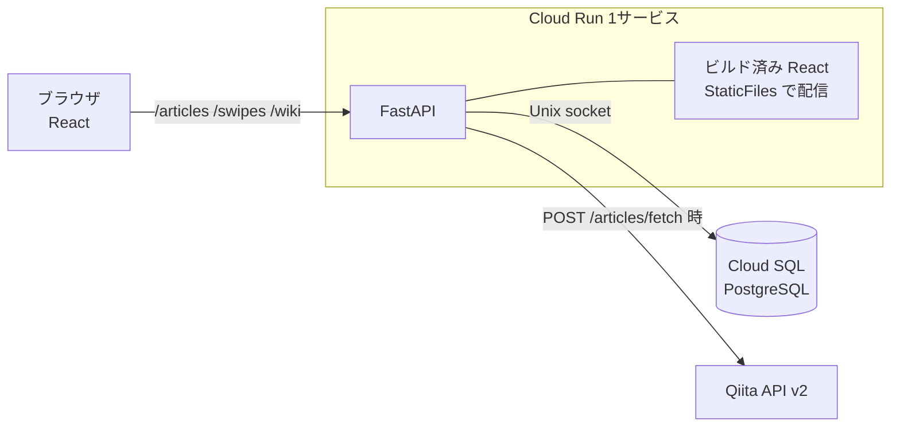

# Swipe Wiki

[](https://github.com/hy-tanebi/swipe-wiki/actions/workflows/ci.yml)

技術記事をスワイプで仕分ける Web アプリ。
Qiita の記事を1件ずつカードで見て、右(残す)/ 左(捨てる)を判定し、残した記事の一覧から元記事へ飛べる。

**なぜ作ったか**: 技術記事を自分から探しに行き、1つ1つ中身を確認する工数を減らしたい。記事は自動で取得し、人は「残す / 捨てる」の判断だけをすればよい状態にする。

- 記事の本文は保存しない(外部 URL へのリンクのみ)
- 1人用・認証なし

## 画面構成

| S1 スワイプ画面 | S2 保存一覧画面 |
|---|---|
|  |  |

## 構成



| 層 | 技術 |
|---|---|
| Frontend | React 19 / TypeScript / Vite / pnpm |
| Backend | Python 3.12 / FastAPI / SQLAlchemy 2.0 / httpx / uv |
| DB | PostgreSQL 16(ローカルは Docker Compose、本番は Cloud SQL) |
| Infra | Docker(マルチステージビルド)/ Cloud Run |
| CI | GitHub Actions(oxlint・型チェック・build / pytest) |

## API

| メソッド | パス | 内容 |
|---|---|---|
| GET | `/articles` | 未判定の記事を返す |
| POST | `/swipes` | 1件の記事に `keep` / `drop` の判定を保存する(未登録の記事は 404、判定済みは 409) |
| GET | `/wiki` | `keep` の記事を、保存した新しい順に返す |
| POST | `/articles/fetch` | Qiita から最新記事を取得し、DB に無いものだけ保存する(Qiita に届かなければ 502) |

詳細は [API 定義](docs/SwipeWiki_03_API定義.md) を参照。

## 設計で判断したこと

- **「捨てる」も判定として保存する**。記事は削除せず、「未判定」は「swipes に判定レコードが無い記事」と定義した。判定のやり直し(一覧から外す)を後から足せる形にしている
- **二重登録は DB の制約で防ぐ**。`articles.url` と `swipes.article_id` をユニークにし、API 側では同じ記事への2回目の判定を 409 で返す
- **記事取得は「新しい記事が見つかるまでページを遡る」**。最新ページが全て取得済みだった場合だけ次のページを見に行き、最大5ページで止める(未認証の Qiita API は 60 リクエスト/時のため、使いすぎない上限)
- **フロントとバックエンドを1つのコンテナにまとめる**。React をビルドして FastAPI の StaticFiles で配信し、Cloud Run 1サービスで完結させた。CORS 設定やサービス間通信が不要になる
- **マイグレーションツールは使わない**。テーブルは2つだけなので `Base.metadata.create_all` で作成する

設計ドキュメント: [要件定義](docs/SwipeWiki_01_要件.md) / [DB 設計](docs/SwipeWiki_04_DB設計.md) / [API 定義](docs/SwipeWiki_03_API定義.md)

## ローカルで動かす

必要なもの: Docker / [uv](https://docs.astral.sh/uv/) / Node.js 22 / pnpm(`corepack enable` で `package.json` の版が入る)

```bash
# 1. 環境変数(.env.example をコピーして値を入れる)
cp .env.example .env

# 2. DB を起動し、テーブルを作る
docker compose up -d
uv sync
uv run python -c "from swipe_wiki.db import Base, engine; import swipe_wiki.models; Base.metadata.create_all(engine)"

# 3. API を起動(http://127.0.0.1:8000)
uv run uvicorn swipe_wiki.main:app --reload

# 4. 別のターミナルでフロントを起動(http://localhost:5173)
pnpm install --frozen-lockfile
pnpm --filter frontend dev
```

記事が0件のときは、S1 の「記事を取得」ボタン(`POST /articles/fetch`)で Qiita から読み込む。

## テスト

```bash
docker compose up -d
uv run pytest
```

- テストは開発用 DB とは別の **`<DB名>_test`** を自動で作って使う(名前が `_test` で終わらない DB には接続しない)
- Qiita API は偽物に差し替えており、ネットワークに依存しない
- CI では Postgres をサービスコンテナで起動し、同じテストを実行する

## デプロイ

`gcloud run deploy` による手動デプロイ。Cloud Run から Cloud SQL へは Unix socket(`--add-cloudsql-instances`)で接続し、`DATABASE_URL` をローカルと切り替える。

## 今後やりたいこと

一覧のソート → 一覧から外す → カテゴリ → お気に入り → 定期取得 → 取得元に Zenn を追加
